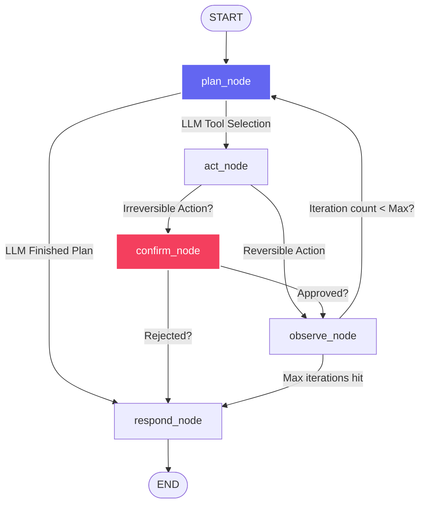

# DailyOps Agent — Operational Personal Assistant

A production-grade, state-machine-driven personal operations assistant powered by **LangGraph** and the **Gemini API**. It triages Gmail, manages tasks in a local database, operates Google Calendar workflows, maintains cross-session preferences using vector embeddings, and enforces human-in-the-loop approvals for irreversible actions.

---

## 🚀 Key Highlights & Architectural Advantages

1. **State-Machine Architecture (LangGraph)**: Unlike simple single-shot chatbot wrappers, this agent uses an explicit state machine for planning, execution, and loops. It plans its tasks, invokes tools, observes the results, updates its plan, and loops until completion.
2. **Human-in-the-Loop Safeguards (Interrupt Flow)**: High-impact actions (`complete_task`, `draft_reply`) are flagged as irreversible. The state machine pauses and saves execution context before they are run. It resumes only when a human provides explicit authorization.
3. **Safe-by-Design Gmail Integration**: Uses `gmail.readonly`, `gmail.compose`, and `gmail.send` scopes. Reply drafts can be created automatically, while actually sending an email is still protected by human confirmation.
4. **Persistent Vector Memory**: Features semantic memory search via local **ChromaDB** and `sentence-transformers` (`all-MiniLM-L6-v2`). The agent continuously identifies user rules (e.g., *"always keep replies short"*) and retrieves them dynamically to customize instructions.
5. **Observability / Tracing Logs**: Appends detailed structured records to `logs/trace.jsonl` tracking why decisions were made, which nodes ran, and what arguments were sent to tools.

---

## 📊 State Machine Workflow



---

## 🛠️ Tech Stack

- **Agent Engine**: `langgraph` (v0.1+)
- **LLM**: Gemini API (`gemini-2.5-flash`)
- **Memory**: `chromadb` + `sentence-transformers`
- **Database**: `SQLAlchemy` + SQLite
- **Backend API**: FastAPI + Uvicorn
- **Frontend**: Vanilla HTML5 / CSS3 (glassmorphic dark mode dashboard)

---

## 📦 Getting Started

### 1. Prerequisites
- **Python 3.10+**
- **Google Cloud Console Credentials**:
  - Enable the **Gmail API** in your Google Cloud project.
  - Create a **Desktop Application** credential.
  - Download the JSON client secret, rename it to `credentials.json`, and place it in the root folder of this project.

### 2. Installation
Install the project dependencies locally:
```bash
pip install -r requirements.txt
```

### 3. Environment Configuration
Create a `.env` file in the root folder (using `.env.example` as a reference) and enter your Gemini API Key:
```env
GEMINI_API_KEY=AIzaSy...your_gemini_key
```

### 4. Verification Check
Test the Gmail authentication and unread email reader script standalone:
```bash
python ./scratch/test_gmail.py
```
*(This will prompt you to authorize Gmail and Calendar access in your local web browser. It saves the session to `token.json` for subsequent silent requests. If you previously authenticated before `gmail.send` was added, delete `token.json` once and re-authenticate.)*

### 5. Running the Backend Server
Start the FastAPI server:
```bash
uvicorn app.main:app --reload --port 8000
```
This runs the API locally at [http://localhost:8000](http://localhost:8000).

### 6. Loading the Dashboard UI
Double-click `frontend/index.html` or host it with any static server to open the dashboard!

---

## 📂 Repository Structure

- `app/agent/`: LangGraph definitions, nodes, states, and client configuration.
- `app/tools/`: Gmail, Calendar, and task tool declarations.
- `app/memory/`: ChromaDB wrappers for embedding vector storage.
- `app/db/`: SQLAlchemy tables and sessions setup.
- `app/tracing/`: JSON lines decision logger (`logs/trace.jsonl`).
- `frontend/`: Dashboard index page.
- `tests/`: Automated unit tests for tools, memory, and graphs.
