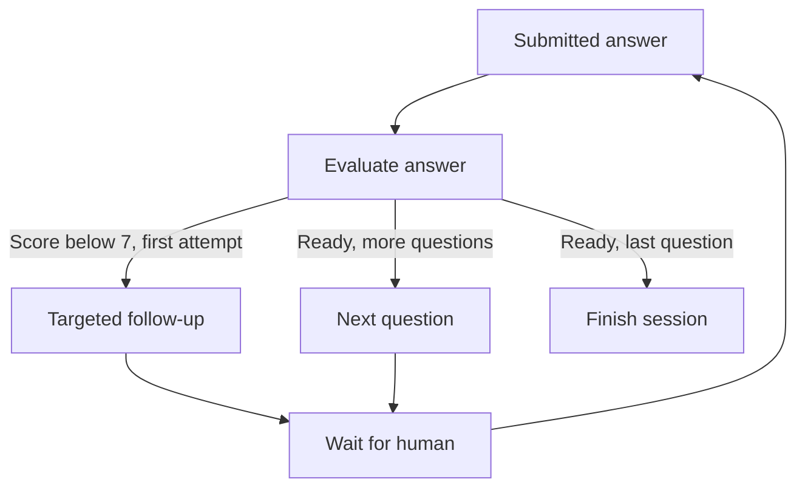

# InterviewGraph

**Practice Python and GenAI interviews with a coach whose workflow you can inspect.**

InterviewGraph is a small Python project built with **LangGraph, LangChain, FastAPI, and SQLite**.
Pick a topic, explain a concept in your own words, and receive feedback. A real LangGraph
conditional edge decides whether to ask a focused follow-up, advance, or finish.

It runs in demo mode without an API key. Connect Gemini for AI evaluation.

## What you can do

- Practice **Python Backend**, **RAG Systems**, or **LangGraph**, with three curated questions per session.
- Receive a score, strengths, missing concepts, and a reference answer.
- Try one targeted follow-up when an answer needs improvement.
- See exactly which graph nodes ran after each answer.
- Resume saved sessions after refreshing the browser or restarting the server.
- Download a plain-text practice report with all attempts.
- Explore and test the API through FastAPI's `/docs` page.

## Run locally

Requires Python 3.11 or later. From this project's `interviewgraph` folder:

```bash
python -m venv .venv
```

Activate on Windows PowerShell:

```powershell
.\.venv\Scripts\Activate.ps1
```

Or on macOS/Linux:

```bash
source .venv/bin/activate
```

Then install and start:

```bash
python -m pip install -r requirements.txt
python -m uvicorn interviewgraph.api:create_app --factory --host 127.0.0.1 --port 8000
```

Open **http://127.0.0.1:8000**. Interactive API docs are at **http://127.0.0.1:8000/docs**.
No `.env` file is required for demo mode.

## Enable Gemini AI feedback

Copy `.env.example` to `.env` in the project folder, then edit it:

```dotenv
COACH_MODE=gemini
GOOGLE_API_KEY=your-own-key
GEMINI_MODEL=gemini-2.5-flash
INTERVIEW_DB=interviews.sqlite3
```

Restart the server after changing configuration. Use a model available to your Google AI account.
Keys are loaded only by the Python server; they are never sent to the frontend. `.env` and local
session databases are excluded from Git. Gemini receives the current question, reference answer,
and submitted answer. API usage may incur provider charges.

**Demo scoring is a keyword coverage exercise, not AI grading.** It cannot reliably judge whether
an explanation is correct or detect negation. Gemini mode checks meaning through a structured
LangChain model response, but its feedback can still be wrong. Scores are for practice only.
No live Gemini call is required by the test suite.

## How the graph works



Each graph invocation processes one submitted answer. Human input arrives through a new API
request between invocations; this project uses application-managed SQLite state rather than
LangGraph's interrupt/checkpointer APIs. There is at most **one follow-up per question**, so
sessions finish after three to six answers. The average uses the **latest attempt per question**.

| Part | Responsibility |
| --- | --- |
| `interviewgraph/graph.py` | Typed state, compiled `StateGraph`, nodes, conditional routing |
| `interviewgraph/evaluators.py` | Honest demo evaluator and Gemini structured output |
| `interviewgraph/questions.py` | Curated prompts, reference answers, concept rubrics |
| `interviewgraph/storage.py` | Durable JSON state and optimistic version guard |
| `interviewgraph/api.py` | Validated HTTP endpoints and report download |
| `interviewgraph/static/` | Responsive dashboard, plain JavaScript, no frontend build step |
| `tests/` | Graph routing, persistence, session/API validation, and failure handling |

## Tests

```bash
python -m pip install -r requirements-dev.txt
python -m pytest -q
node --check interviewgraph/static/app.js
```

Node is optional for running the application; it is used only for the JavaScript syntax check.
Tests inject the demo evaluator or a failing evaluator and make no Gemini API calls.
Dependencies are bounded for compatibility. The included GitHub Actions workflow runs the
suite on Python 3.11 and 3.12 using freshly resolved packages.

## API example

Create a session:

```http
POST /api/sessions
Content-Type: application/json

{"topic": "langgraph"}
```

Submit an answer using the `id` and current `version` from the previous response:

```http
POST /api/sessions/{id}/answers
Content-Type: application/json

{"answer": "State holds shared data, nodes return updates, and conditional edges route the next step.", "version": 0}
```

Concurrent/stale submissions receive `409`; provider failures receive `503` without advancing
the session. The browser preserves unsubmitted text when recovering from a stale session.

## Scope

This is a **local, single-operator portfolio project**. The server binds to loopback and validates
hostnames. Session IDs are random, but they are not a user authentication system. Add real login,
ownership checks, quotas, and deployment controls before offering it as a public service.
The question bank has nine questions; add new `Question` entries to expand it.

## Explain it in an interview

"I built a Python interview coach with LangGraph. I separated evaluation from routing: one node
produces structured feedback, then a conditional edge chooses a follow-up, next question, or
finish. I persist validated state between requests in SQLite, use version checks against duplicate
submissions, and handle model failures without losing progress. A deterministic demo evaluator
lets me exercise the workflow without making paid API calls."

## References

- [LangGraph Graph API](https://docs.langchain.com/oss/python/langgraph/graph-api)
- [LangChain Google Gemini integration](https://docs.langchain.com/oss/python/integrations/chat/google_generative_ai)
- [FastAPI documentation](https://fastapi.tiangolo.com/)
